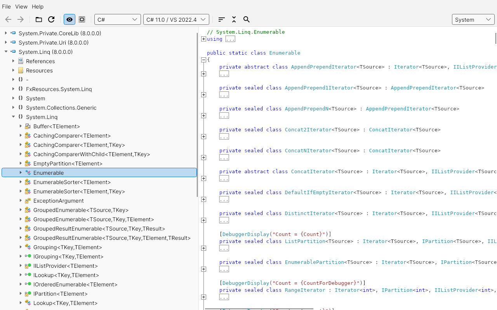
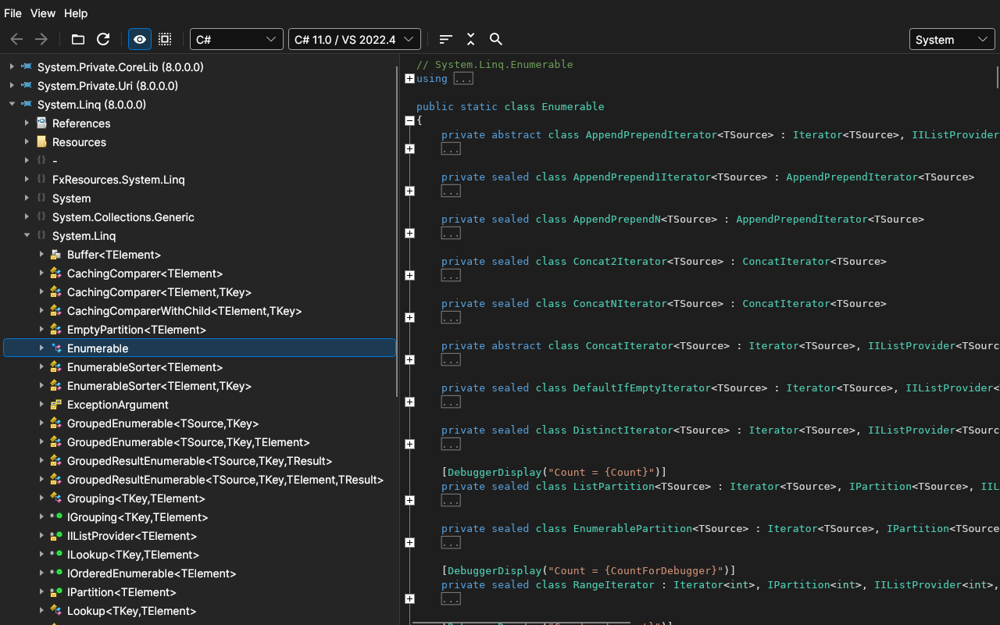
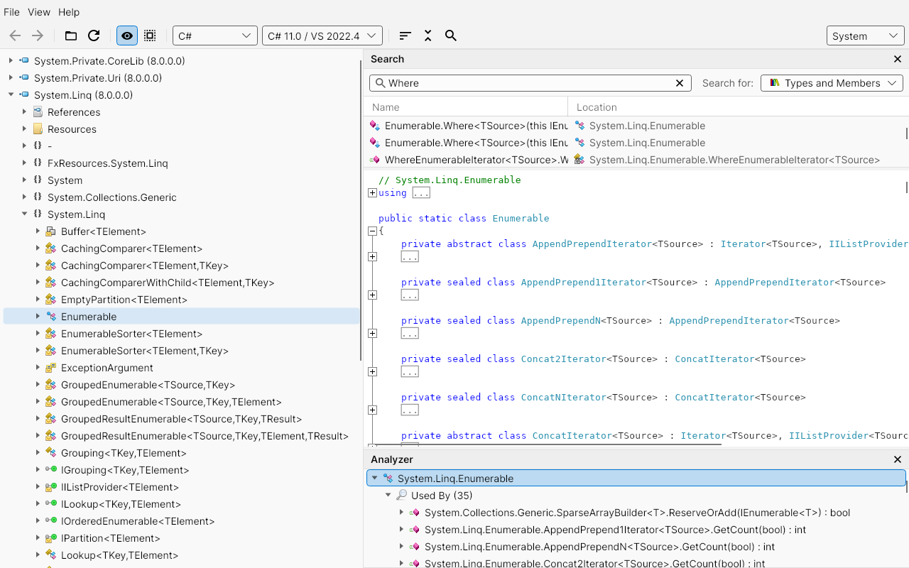
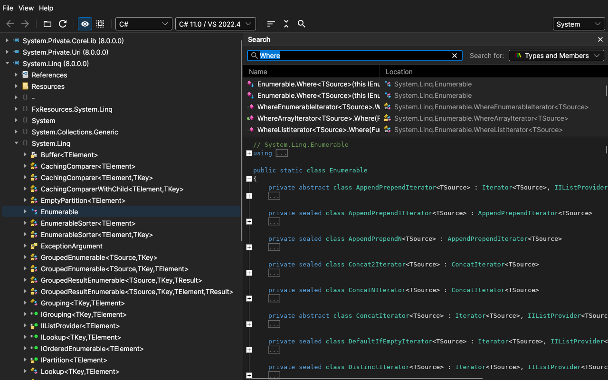
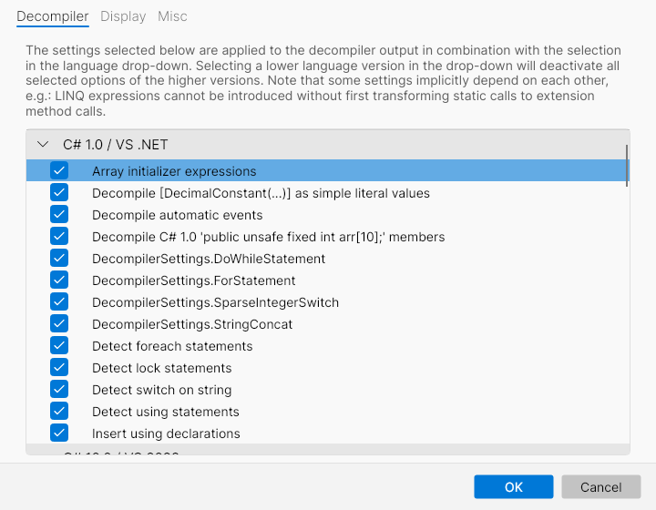
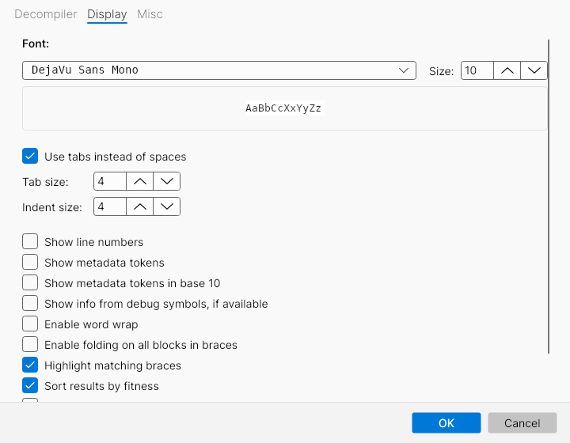
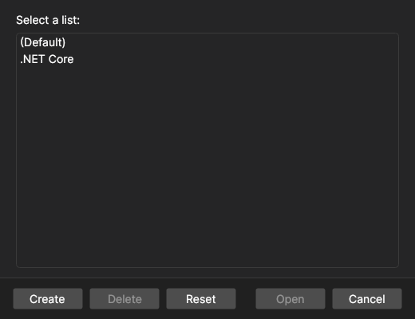
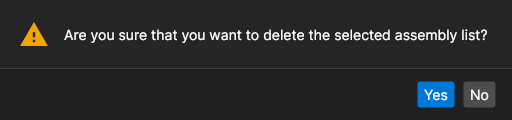

# AvaloniaILSpy (community fork)

> **This is an unofficial fork of [icsharpcode/AvaloniaILSpy](https://github.com/icsharpcode/AvaloniaILSpy), which has been archived by its maintainers.**
> It is not affiliated with or supported by the ILSpy team. Please report problems with this fork here, not upstream.

### What's different in this fork

* Updated to **.NET 8** and **Avalonia 11** (Fluent theme, AvaloniaEdit 11, DataGrid 11)
* Refreshed UI: vector toolbar icons, modern tree view, redesigned dialogs and search pane
* **Light / Dark / System** theme switching, including dark syntax highlighting for C# and IL
* Code uses a monospaced font by default; keyboard shortcuts follow the platform (Cmd on macOS), plus Alt+Left/Right and mouse back/forward buttons for navigation
* Numerous bug fixes, among others: files written by "Save" are truncated before writing, the NuGet package browser and plugin option pages load again, assertion dialogs no longer crash on Linux/macOS, Yes/No message boxes default to "Yes", drag & drop targets in the tree are computed correctly, and assembly icons update after loading

## Screenshots

| Light theme | Dark theme |
| --- | --- |
|  |  |
|  |  |

| Options: Decompiler | Options: Display |
| --- | --- |
|  |  |

| Assembly lists | Message box |
| --- | --- |
|  |  |

## Upstream archival notice

> As outlined in issue #136 we were looking for maintainers, but nobody stepped forward. Thus it has been unmaintained for a very long period of time, 
> and we decided to archive the repository.
>
> Alternative: [ilspy-vscode](https://marketplace.visualstudio.com/items?itemName=icsharpcode.ilspy-vscode) has more features than AvaloniaILSpy ever had and
> is available on all platforms thanks to VS Code. See [feature comparison](https://github.com/icsharpcode/ilspy-vscode/wiki/Feature-Comparison) for what is 
> not there compared to the WPF/Windows version of ILSpy. All future xplat work is focused on the VS Code extension.
>
> We do not intend to resurrect a "copy of ILSpy with UI framework XYZ" as this project has proven how hard it is to keep a copy up to date.

## About

This is cross-platform version of [ILSpy](https://github.com/icsharpcode/ILSpy) built with [Avalonia](https://github.com/AvaloniaUI/Avalonia).

### Supported Features
 * Decompilation
 * Analyze Window
 * Search for types/methods/properties (substring)
 * Hyperlink-based type/method/property navigation
 * Extensible via MEF Extensibility (Check out TestPlugin folder). Note: This is not compatible with ILSpy Plugins.
 * Check out [feature support status](https://github.com/icsharpcode/AvaloniaILSpy/issues/1)

## Download

Builds of this fork are produced by the GitHub Actions workflow of this repository (Linux, macOS and Windows).
The last official upstream releases are still available at https://github.com/icsharpcode/AvaloniaILSpy/releases.

How to run on Linux: 
- just open it
- if you have trouble, please try to grant it the rights to execute `chmod a+x ILSpy`
- you could also run it in command line by `./ILSpy`

How to run on Mac:
- just move the app into `/Applications` folder and open it
- run `xattr -rd com.apple.quarantine /Applications/ILSpy.app`
- if you see `“ILSpy” cannot be opened because the developer cannot be verified.`, please open up `System Preferences` -> `Security & Privacy` -> `General` -> `Open Anyway` 
- if you see the error `The application ILSpy can't be opened' error on launch`, you could `chmod +x "/Applications/ILSpy.app/Contents/MacOS/ILSpy"`

## Build from sources

1. Install the .NET 8 SDK or above from https://dotnet.microsoft.com/en-us/download/dotnet
2. Clone repository : `git clone https://github.com/Toemmsen96/AvaloniaILSpy.git`.
3. Run build script: `dotnet tool restore` and `dotnet cake`
4. Artifacts will be located in subdirectory `artifacts`.

To just run it from source: `dotnet run --project ILSpy`.
